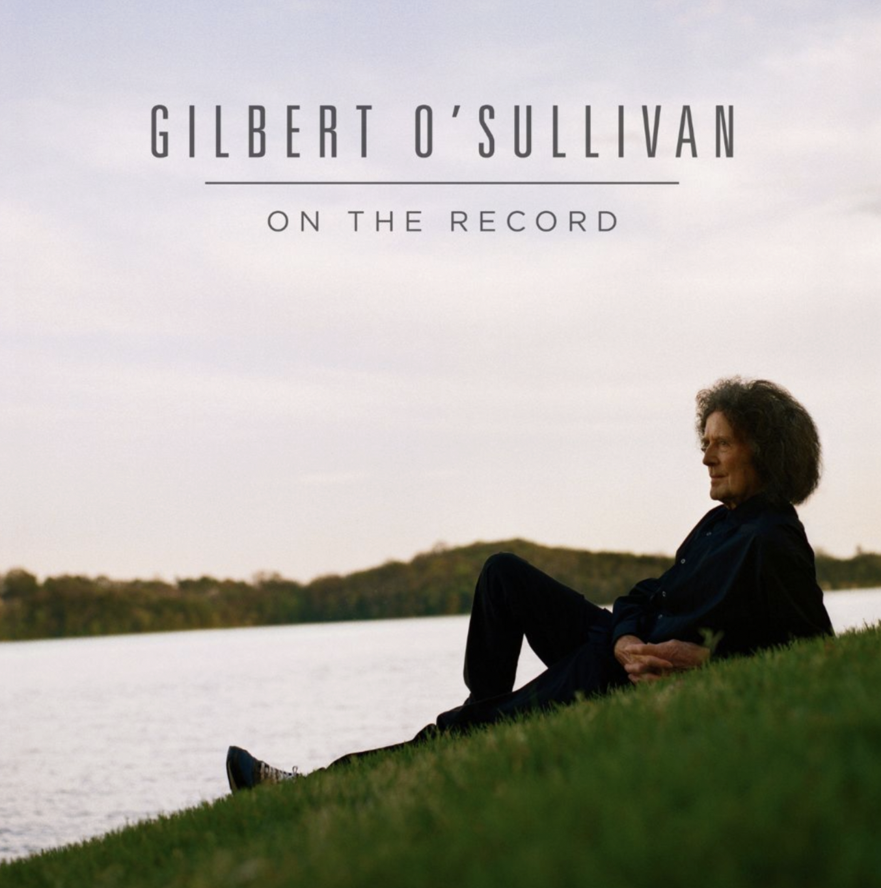

It’s an honour to be at the helm for a Gilbert O’Sullivan album… but a particularly special honour to be there for three! On the Record is another collection of finely honed songs written by a master craftsman. Gilbert writes with absolute dedication, working a ‘9-5’ in his music room at home in Jersey for as many months as it takes to perfect a set of songs. 

The next step is to play them to me - and for me to choose twelve or so that I think will fit together. We then take them to the studio (in this instance, Eastcote Studios in West London) and record them with the musicians I have put together. So, a lot of responsibility, but a task I take on with great pride. The resulting album is already garnering five-star reviews, and Gilbert’s sold-out tour (including a 6,000-strong audience in Dublin) marks him as a national treasure. There’s still more to come, I expect!
