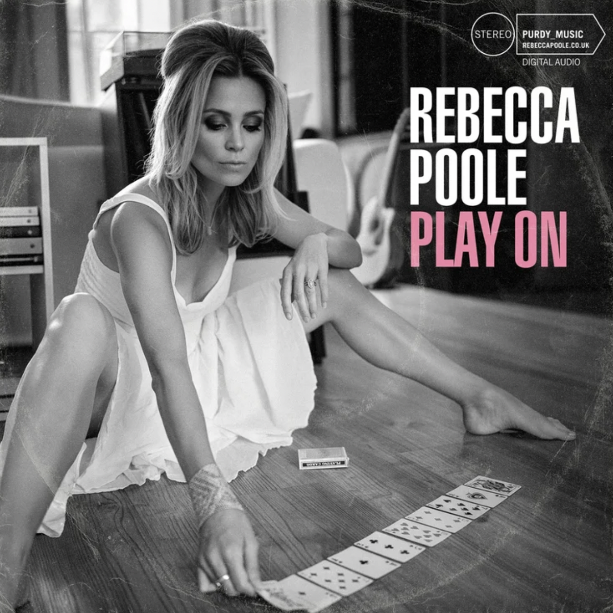

‘Play On’ is the fourth album Rebecca has made with me, two as Purdy, one as a collaborative songwriter, and this one – where as well as producing, I’ve written many of the songs together with her. 

The success of ‘Dreamers Ball’ (the previous album) at Jazz FM was as pleasing for me as anything I have worked on in recent years and, in my opinion, is long overdue and richly deserved. 

Rebecca’s voice has hit a resonance with her audience, and she is a joy to record.
High hopes for this wonderful album.
