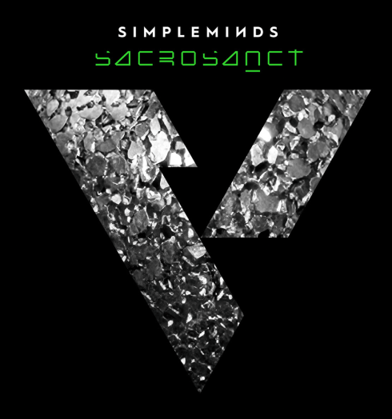

Sacrosanct is our fifth studio album with Simple Minds. We also mixed the live albums ‘Live in the City of Angels’ and ‘Live in the City of Diamonds’, so for Gavin and me, this is a treasured achievement. 

Our long-standing collaboration with Jim and Charlie has been made all the better by their consummate professionalism, but also, their company is equally delightful. Sacrosanct is scheduled for release in January, and initial reactions have been really strong. Both Gavin and I feel that this is our best piece of work with Simple Minds and have high hopes for its success.
